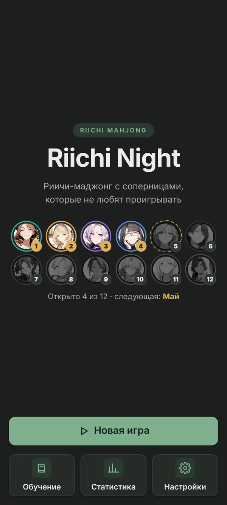
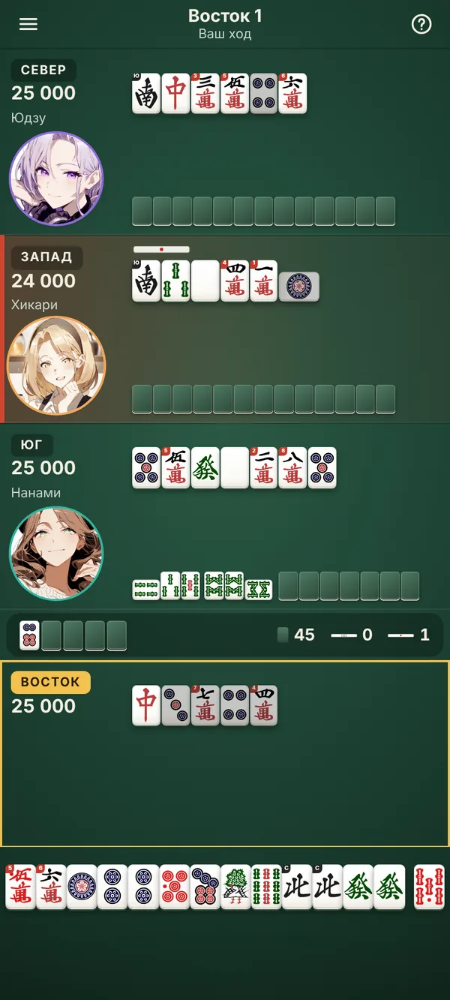
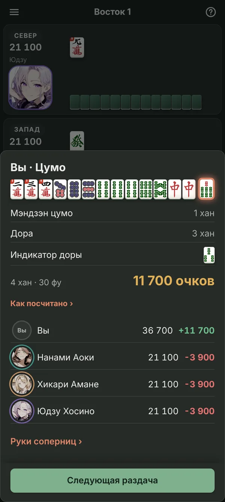
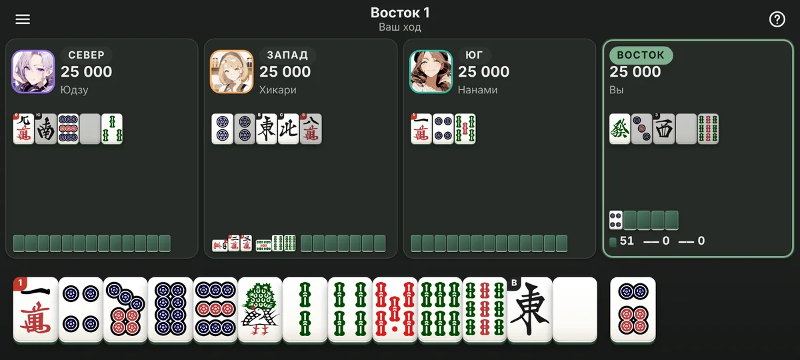

# Riichi Night

Офлайн риичи-маджонг для Android: ты против трёх аниме-героинь. Двенадцать
соперниц, от новичка до нейросети [Mortal](https://github.com/Equim-chan/Mortal).
Работает без интернета, без рекламы и покупок.

**[Скачать последнюю версию (APK)](https://github.com/bogdanpetrenko13/RiichiNight/releases/latest)**

<p>
  
  
  
</p>


## Установка

1. Открой [страницу последнего релиза](https://github.com/bogdanpetrenko13/RiichiNight/releases/latest) и скачай `RiichiNight-vX.Y.Z.apk`.
2. Открой файл на телефоне и разреши установку из этого источника.
3. Новые версии ставятся поверх старых: сохранения и прогресс остаются.

Нужен Android с Android System WebView 105 или новее (обновляется через Google Play).

## Что в игре

- **Двенадцать соперниц по ступеням сложности.** Ступени 1–6 играют эвристическим ИИ со своим стилем (кто-то любит объявления, кто-то флеши, кто-то осторожен), ступени 7–12 играют Mortal с разной долей ошибок, а Цукико на 12-й ступени играет в полную силу. Сначала открыты четыре соперницы, каждая следующая открывается за 1-е место в партии с предыдущей.
- **Героини за столом.** Портреты с плавной сменой эмоций и реакциями, реплики в облачках (у героинь есть общая история), голоса на риичи, пон, чи, кан, рон и цумо.
- **Стол как в настоящем маджонге.** Сеты с повёрнутым забранным тайлом, тайл риичи боком, палочки риичи на столе, кубики в первой раздаче. Анимации сброса, перестроения руки и переворота доры. Звуки настоящих тайлов, вибрация. Два стиля стола («Тихий» и «Сукно» шести цветов), пять наборов тайлов, светлая и тёмная темы, вертикальный и горизонтальный режимы.
- **Итог раздачи по шагам.** Тайлы, выигрышный тайл, яку по одному (твой голос называет их), ура-дора, счёт очков и название лимита. «Как посчитано» раскладывает фу и выплаты, «Руки соперниц» показывает, что у них было.
- **Подсказки.** Ожидания и фуритен, тайлы для риичи, чи, пон и кан, цумогири в сбросе, безопасные тайлы против риичи (по желанию), подсветка копий тайла долгим нажатием.
- **Управление.** Сброс свайпом вверх или двойным нажатием, быстрые настройки прямо за столом.
- **Правила.** Восток или ханчан, красные пятёрки, тоби, агари-ямэ, кирияге-манган, куитан.
- **Обучение и статистика.** Уроки с вопросами «Проверь себя», справочник яку с примерами рук, статистика, достижения и счёт против каждой героини.

## Лицензия

Код распространяется по **GNU AGPL-3.0-or-later** (`LICENSE`), потому что в
игру входит Mortal. Полный список компонентов и их лицензий — в `NOTICE.md`.

Благодарности:

- [Mortal](https://github.com/Equim-chan/Mortal) (Equim-chan, AGPL-3.0) и веса [Mortal S42](https://huggingface.co/haor/Mortal-S42) (haor, Apache-2.0): сильные соперницы.
- [pyriichi](https://github.com/d4n1elchen/pyriichi) (MIT): движок правил; [Pyodide](https://pyodide.org) (MPL-2.0): Python в WebAssembly.
- [FluffyStuff/riichi-mahjong-tiles](https://github.com/FluffyStuff/riichi-mahjong-tiles) (CC0): рисунки тайлов.
- [VOICEVOX](https://voicevox.hiroshiba.jp/): голоса героинь, полный список голосов в `public/voice/CREDITS.md` и в игре (Настройки → «О программе»).
- [Free Sound Mahjong Sound Pack](https://t-studio-tst.itch.io/free-sound-mahjong-sound-pack) (みんなの創作支援サイトＴスタ): звуки стола и голос игрока.
- Портреты героинь сгенерированы локально моделью [Animagine XL 4.0](https://huggingface.co/cagliostrolab/animagine-xl-4.0) (CreativeML Open RAIL++-M), подробности в `public/characters/CREDITS.md`. Все героини взрослые.

---

## Для разработчиков

Стек: React 18 + TypeScript + Vite, чистый CSS (модули + переменные), движок
правил pyriichi в Pyodide внутри Web Worker, Mortal на Rust, собранный в
WebAssembly, упаковка в APK через Capacitor 6, сборка через GitHub Actions.

```
React UI ──postMessage──▶ engine.worker.ts ──▶ Pyodide ──▶ bridge.py ──▶ pyriichi
         ◀── {events, view} ──┘                                  └──▶ mortal.py ──▶ mortal.wasm
```

### Быстрый старт

```bash
npm install          # postinstall копирует Pyodide в public/pyodide (офлайн, без CDN)
scripts/mortal/ci_setup.sh wasm   # собрать Mortal в wasm и скачать веса (нужны Rust и сеть)
npm run dev          # http://localhost:5173
npm run android:sync # сборка + cap sync (после `npx cap add android` один раз)
```

### Проверки

```bash
node node_modules/typescript/bin/tsc -p tsconfig.app.json --noEmit   # типы
PYTHONPATH=public/py/pyriichi.zip python -m pytest tests/python -q     # движок в CPython
npm run test:pyodide                                                   # ханчан в настоящем Pyodide
node scripts/check-css-compat.mjs                                      # CSS для WebView 105
npm run build && E2E_DIST=dist python -m pytest tests/e2e -q           # браузерные тесты (Playwright)
```

Для браузерных тестов есть подстроенные раздачи (`?scenario=tsumo`, `riichi`,
`mychi`, `rinshan` и другие, см. `public/py/scenarios.py`) и сиды (`?seed=7`).

### Сборки и релизы

CI (`.github/workflows/android.yml`) гоняет тесты движка, веб-сборку, проверку в
Pyodide, браузерные тесты и собирает APK, подписанный постоянным отладочным
ключом (поэтому сборки ставятся поверх друг друга). Каждый коммит в `main`
публикуется как пре-релиз **dev-latest**. Тег `vX.Y.Z` (он должен совпадать с
версией в `package.json`) публикует `RiichiNight-vX.Y.Z.apk` с заметками из
`docs/releases/vX.Y.Z.md`.

### Где что лежит

| Путь | Что там |
|---|---|
| `public/py/bridge.py` | JSON-мост к pyriichi: `new_game`, `act`, `ai_step`, `next_round`, `save`, `load`. Отдаёт UI только то, что видит игрок |
| `public/py/ai.py` | Эвристический ИИ: уровень (доля ошибок) и стиль (защита, объявления, дама, флеши, стоимость) |
| `public/py/mortal.py`, `public/py/mjai.py` | Соперницы на Mortal: партия в событиях mjai, перевод ходов в pyriichi |
| `public/py/rulefix.py`, `yakufix.py`, `calcinfo.py` | Исправления правил и подсчёта pyriichi (сверены с Mortal) и разбор очков для итога |
| `public/py/fastpatch.py` | Ускорение поиска темпая в pyriichi через таблицу шантена |
| `native/mortal/` | Rust: подмножество libriichi, сеть Mortal v4 (SIMD в wasm), бот, C ABI |
| `src/engine/` | Протокол, воркер, RPC-клиент, загрузка Python (`pyBoot.js`) |
| `src/game/` | Героини и их реплики, сохранения, звук, голос, вибрация, контроллер партии |
| `src/ui/` | Экраны, стол, анимации (`motion.ts`, `tableFx.ts`) |
| `tests/python`, `tests/e2e` | Тесты движка и браузерные тесты |

**Сохранения.** После каждого решения игрока и в конце раздачи вся партия
сериализуется (`pickle` → base64) в `@capacitor/preferences`. «Продолжить»
восстанавливает её с того же места, в том числе в сборках новее той, где игра
была сохранена.

**Сила соперниц.** Уровни героинь откалиброваны workflow **AI strength**
(400 партий на ступень против трёх Mortal): среднее место ровно растёт от ~3,6
на 1-й ступени до ~2,5 на 12-й.

### Арт и озвучка

Файлы подхватываются по соглашению об именах:

```
public/characters/<id>/portrait.webp            портрет, квадрат ~512px
public/characters/<id>/emotions/<emotion>.webp  neutral | happy | troubled
public/voice/<id>/<kind>.mp3                    riichi | pon | chi | kan | ron | tsumo
```

Эмоции получены из портрета через img2img + IP-Adapter
(`scripts/comfy/gen_emotions.py`), в игру их переносит
`scripts/import-heroine-art.py`. Голоса генерирует `scripts/voicevox/`.
Иконку и заставки рисует `scripts/make-icons.py night` (вектор).
